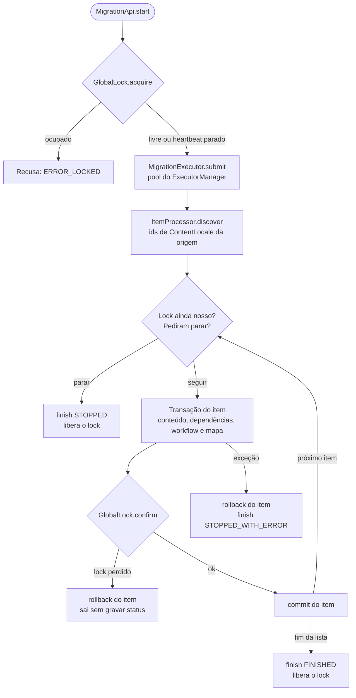

# Requisitos e comportamento da migração de conteúdo

Este documento define os requisitos de uma ferramenta que migra conteúdos entre duas instâncias do mesmo serviço LumisXP e mostra como o serviço `br.com.lumis.commons.contentmigrator.service.contentmigration`, do módulo Content Migrator, atende a cada um. O alvo é o LumisXP 19.0.0. Cada tema segue a mesma ordem: **Requisito**, o que a ferramenta deve fazer, de forma verificável; **Como o módulo atende**, com as referências de código; e **O que avaliar na adoção**, as decisões que cada projeto toma ao usar ou adaptar o módulo. O serviço `hierarchicalcontentmigration`, que reaproveita esse fluxo para conteúdo hierárquico, está descrito em [hierarchicalcontentmigration.md](../hierarchicalcontentmigration.md).

Os requisitos são identificados de `RQ-01` a `RQ-08`, e as decisões e informações necessárias na adoção, de `AD-01` a `AD-07`; o levantamento técnico da plataforma usa os mesmos identificadores. Os links para o código deste módulo trazem as linhas também no texto (`Classe.método, linhas a-b`), para que a referência continue legível onde a âncora de linha não é aplicada. As afirmações sobre a plataforma citam métodos como `ContentTableSource#updateData` e `PagePersonalizationUtil#cloneWidgetsIfNeeded`; os arquivos e as linhas de cada fato estão no levantamento interno `docs/internal/evidencias-plataforma-lumis.md`, feito nas fontes do LumisXP 18.1.1, versão de que o módulo foi portado, e não reconferido na 19.0.0.

## Visão geral da ferramenta

**Requisito RQ-01:** a ferramenta copia conteúdos de uma instância de origem para uma instância de destino diferente, do mesmo serviço, e controla cada migração por cinco operações com efeitos delimitados: criar, executar, parar, reverter e excluir.

**Como o módulo atende:** `MigrationApi` implementa as cinco operações. Antes de criar uma migração, o serviço valida que origem e destino usam o mesmo serviço, o mesmo workflow e dependências compatíveis, como descreve o [README do módulo](../../README.md). A tabela mostra o requisito de cada operação e onde o módulo o implementa; os links exibem a classe, o método e as linhas relevantes.

| Operação | Requisito | Como o módulo atende |
| --- | --- | --- |
| Criar | Registrar a migração sem iniciar a cópia e recusar um par de instâncias inválido. | [MigrationApi.create, linhas 78-113](../../src/br/com/lumis/commons/contentmigrator/service/contentmigration/api/MigrationApi.java#L78-L113) valida o par de instâncias e grava a migração parada; os itens são descobertos ao iniciar |
| Executar | Processar a migração em segundo plano, uma execução por vez. | [MigrationApi.start, linhas 389-417](../../src/br/com/lumis/commons/contentmigrator/service/contentmigration/api/MigrationApi.java#L389-L417) adquire o lock e submete a execução na hora |
| Parar | Interromper a execução sem deixar um item gravado pela metade. | [MigrationApi.stop, linhas 437-452](../../src/br/com/lumis/commons/contentmigrator/service/contentmigration/api/MigrationApi.java#L437-L452) grava `stopRequested`, lido entre itens |
| Reverter | Desfazer no destino o que a migração criou, sem concorrer com outra execução. | [MigrationApi.undo, linhas 523-549](../../src/br/com/lumis/commons/contentmigrator/service/contentmigration/api/MigrationApi.java#L523-L549) roda em background sob o mesmo lock |
| Excluir | Remover o registro da migração sem apagar o conteúdo já gravado no destino. | [MigrationApi.delete, linhas 462-486](../../src/br/com/lumis/commons/contentmigrator/service/contentmigration/api/MigrationApi.java#L462-L486) remove os mapas de conteúdo e mantém o conteúdo do destino |

As tabelas de controle estão em [databasedefinition.xml, linhas 4-137](../../src/br/com/lumis/commons/contentmigrator/service/contentmigration/componentfiles/setup/databasedefinition.xml#L4-L137).

**O que avaliar na adoção:** o módulo executa a migração quando o operador a inicia e não oferece agendamento periódico. Um projeto que precise de agendamento ou de uma fila própria pode comparar seu fluxo com as operações da tabela e com os pontos de RQ-06 antes de definir o que adotar.

## Pontos-chave da execução

**Requisito RQ-02:** a execução roda em segundo plano, fora da requisição do operador; permite uma só execução por vez, inclusive entre servidores; grava cada item em uma transação própria, que inclui conteúdo, dependências, workflow e mapa; atende ao pedido de parada entre itens; e registra a falha sem deixar item parcial no destino.

**Como o módulo atende:** quando o operador inicia uma migração, `MigrationApi.start` adquire o lock e envia a tarefa ao executor do Portal. Uma thread de segundo plano executa a operação; na cópia, cada `ContentLocale` é processado em uma transação própria.

1. **Início e thread.** [MigrationApi.start, linhas 389-417](../../src/br/com/lumis/commons/contentmigrator/service/contentmigration/api/MigrationApi.java#L389-L417) chama [MigrationExecutor.submit, linhas 27-49](../../src/br/com/lumis/commons/contentmigrator/service/contentmigration/execution/MigrationExecutor.java#L27-L49), que entrega [MigrationTask.run, linhas 104-138](../../src/br/com/lumis/commons/contentmigrator/service/contentmigration/execution/MigrationTask.java#L104-L138) ao `ExecutorManager`. A tarefa personifica o usuário recebido na chamada e abre as transações necessárias na thread de execução.
2. **Lock e heartbeat.** Uma linha de `lum_cmig_MigLock` coordena as migrações entre servidores. [GlobalLock.acquire, linhas 76-94](../../src/br/com/lumis/commons/contentmigrator/service/contentmigration/lock/GlobalLock.java#L76-L94) adquire um lock livre ou sem heartbeat há mais de cinco minutos, segundo o relógio do banco. [MigrationTask.renewHeartbeat, linhas 148-169](../../src/br/com/lumis/commons/contentmigrator/service/contentmigration/execution/MigrationTask.java#L148-L169) renova o heartbeat a cada 60 segundos por padrão; se um item ultrapassar o limite de tempo, a renovação pausa.
3. **Transação por item.** [ItemProcessor.processOnce, linhas 172-236](../../src/br/com/lumis/commons/contentmigrator/service/contentmigration/copy/ItemProcessor.java#L172-L236) grava conteúdo, dependências, workflow e mapa na mesma transação. Antes do commit, [GlobalLock.confirm, linhas 124-138](../../src/br/com/lumis/commons/contentmigrator/service/contentmigration/lock/GlobalLock.java#L124-L138) confirma que o `runId` ainda detém o lock. A descoberta inicial carrega os identificadores dos `ContentLocale`; cada item lê e grava os dados na própria transação.
4. **Parada entre itens.** [MigrationApi.stop, linhas 437-452](../../src/br/com/lumis/commons/contentmigrator/service/contentmigration/api/MigrationApi.java#L437-L452) registra o pedido. [MigrationTask.migrateItems, linhas 184-211](../../src/br/com/lumis/commons/contentmigrator/service/contentmigration/execution/MigrationTask.java#L184-L211) verifica esse pedido antes de cada item; o item atual termina ou sofre rollback por inteiro.
5. **Falha e perda do lock.** Uma exceção de processamento leva a [MigrationTask.recordFailure, linhas 342-353](../../src/br/com/lumis/commons/contentmigrator/service/contentmigration/execution/MigrationTask.java#L342-L353) e [RunStatusUpdater.finish, linhas 125-152](../../src/br/com/lumis/commons/contentmigrator/service/contentmigration/execution/RunStatusUpdater.java#L125-L152), que registram `STOPPED_WITH_ERROR` e liberam o lock. Se outra execução tomar o lock, o item em andamento sofre rollback e a tarefa sai sem atualizar o status da migração antiga.

**O que avaliar na adoção:** qual estado mostrar quando uma execução perde o lock; no módulo, a tomada do lock não altera o status da execução anterior.

## addData, updateData, workflow e versões

**Requisito RQ-03:** a cópia grava pela source do serviço de destino, para que os hooks da plataforma sejam executados; reproduz no destino as versões publicada e ativa da origem, o estado de workflow, o responsável válido no destino, a autoria, as datas e os comentários; e mantém a identidade de cada `ContentLocale` copiado, mesmo quando uma atualização versionada devolve outro itemId.

Isso é necessário porque, na plataforma, `addData` cria um conteúdo novo e `ContentTableSource#addData` executa os hooks de inserção, enquanto `updateData` altera o conteúdo identificado no destino. Com `VersionActive`, `ContentTableSource#updateData` cria outra linha de negócio e pode devolver outro itemId. `addData` não copia, por si só, as versões publicada e ativa nem o estado de workflow da origem.

**Como o módulo atende:**

- [ContentCopier.buildData, linhas 107-135](../../src/br/com/lumis/commons/contentmigrator/service/contentmigration/copy/ContentCopier.java#L107-L135) monta os dados de cada versão a partir do escopo da migração (`MigrationScope`) e da versão a copiar (`VersionCopy`). [ContentCopier.shouldCopyField, linhas 172-184](../../src/br/com/lumis/commons/contentmigrator/service/contentmigration/copy/ContentCopier.java#L172-L184) exclui a chave primária da origem. [ContentCopier.putIdentityParameters, linhas 137-160](../../src/br/com/lumis/commons/contentmigrator/service/contentmigration/copy/ContentCopier.java#L137-L160) identifica o destino por idioma e `contentId`. [ItemProcessor.writeVersionData, linhas 464-474](../../src/br/com/lumis/commons/contentmigrator/service/contentmigration/copy/ItemProcessor.java#L464-L474) usa `addData` quando o `ContentLocale` de destino ainda não existe e `updateData` nas demais gravações.
- [ItemProcessor.buildOriginVersionsToCopy, linhas 425-435](../../src/br/com/lumis/commons/contentmigrator/service/contentmigration/copy/ItemProcessor.java#L425-L435) seleciona as versões publicada e ativa, e [ItemProcessor.copyVersions, linhas 365-391](../../src/br/com/lumis/commons/contentmigrator/service/contentmigration/copy/ItemProcessor.java#L365-L391) grava cada uma delas. [ItemProcessor.copyLocaleMetadata, linhas 393-413](../../src/br/com/lumis/commons/contentmigrator/service/contentmigration/copy/ItemProcessor.java#L393-L413) define a versão publicada do destino e aplica tags. [ItemProcessor.saveItemMap, linhas 505-536](../../src/br/com/lumis/commons/contentmigrator/service/contentmigration/copy/ItemProcessor.java#L505-L536) guarda a identidade estável de `ContentLocale`, mesmo quando a gravação versionada devolve outro itemId.
- [WorkflowCloner.copyState, linhas 154-161](../../src/br/com/lumis/commons/contentmigrator/service/contentmigration/copy/WorkflowCloner.java#L154-L161) grava o estado e o responsável na transação do item, sem executar uma transição. [WorkflowCloner.resolveAssignedTo, linhas 95-120](../../src/br/com/lumis/commons/contentmigrator/service/contentmigration/copy/WorkflowCloner.java#L95-L120) preserva o responsável apenas se ele tiver papel no destino. Na atualização, [WorkflowCloner.returnToStartState, linhas 41-48](../../src/br/com/lumis/commons/contentmigrator/service/contentmigration/copy/WorkflowCloner.java#L41-L48) retorna o destino ao estado inicial antes de `updateData`, pois `WorkflowManager#hasEditPermission`, consultado pelo `WorkflowController`, pode impedir a edição de conteúdo publicado. [AuthorshipCloner.copy, linhas 25-46](../../src/br/com/lumis/commons/contentmigrator/service/contentmigration/copy/AuthorshipCloner.java#L25-L46) restaura autoria, datas e comentários após a gravação.

**O que avaliar na adoção:** se a política de versões e workflow do destino deve espelhar a origem; quais papéis os responsáveis têm no destino; e se a ferramenta grava diretamente os metadados de workflow, como o módulo, ou executa transições, que podem disparar efeitos editoriais. A gravação direta escreve na tabela interna `lum_WorkflowMetaData`, um detalhe de implementação da plataforma que cada atualização do LumisXP precisa reconfirmar. Cada projeto também decide se preserva a autoria original.

## Campos HTML e widgets embutidos

**Requisito RQ-04:** um conteúdo com HTML e widgets embutidos é criado no destino em uma única gravação, sem a chave primária da origem; cada embed passa a apontar para o widget equivalente no repositório de destino, com o HTML de cada área processado pelo utilitário da plataforma, e não por expressão regular sobre o JSON bruto; e um widget sem equivalente mapeado bloqueia o item antes da gravação.

Isso é necessário porque, na plataforma, o `addData` pode receber o HTML sem a chave primária da origem, mas a exceção *Unable to get content version by item id* ocorre quando o hook nativo tenta localizar uma versão a partir dessa chave e não a encontra (`HtmlDataType#preAdd`, `PagePersonalizationUtil#cloneWidgetsIfNeeded`). O clone nativo trata as instâncias embutidas, mas não mapeia sozinho um widget para seu equivalente em outro repositório (`PagePersonalizationUtil#cloneWidgetsIfNeeded`); essa associação fica a cargo da ferramenta.

**Como o módulo atende:**

1. Mantém o HTML no payload de criação e exclui a chave primária da origem ([ContentCopier.shouldCopyField, linhas 172-184](../../src/br/com/lumis/commons/contentmigrator/service/contentmigration/copy/ContentCopier.java#L172-L184)). Antes da gravação, [ContentCopier.prepareClonedValue, linhas 316-335](../../src/br/com/lumis/commons/contentmigrator/service/contentmigration/copy/ContentCopier.java#L316-L335) aplica os handlers de dependência.
2. Processa cada área do HTML com `HtmlDataTypeUtil#processAreasHtml` e reescreve os embeds para o widget de destino ([WidgetDependencyHandler.rewriteHtml, linhas 180-205](../../src/br/com/lumis/commons/contentmigrator/service/contentmigration/dependency/widget/WidgetDependencyHandler.java#L180-L205); [WidgetDependencyHandler.rewriteArea, linhas 211-269](../../src/br/com/lumis/commons/contentmigrator/service/contentmigration/dependency/widget/WidgetDependencyHandler.java#L211-L269)). Quando as interfaces coincidem, [WidgetDependencyHandler.copyEmbedConfigurationIfSameInterface, linhas 276-300](../../src/br/com/lumis/commons/contentmigrator/service/contentmigration/dependency/widget/WidgetDependencyHandler.java#L276-L300) copia propriedades e preferências.
3. Se faltar o mapeamento, [WidgetDependencyHandler.precheckHtml, linhas 132-171](../../src/br/com/lumis/commons/contentmigrator/service/contentmigration/dependency/widget/WidgetDependencyHandler.java#L132-L171) bloqueia o item antes de gravar. O operador pode mapear o widget e retomar a migração, como cobre [WidgetMigrationTest.blocksWithoutMappingThenResumesAndRewritesEveryEmbed, linhas 106-182](../../test/java/br/com/lumis/commons/contentmigrator/service/contentmigration/test/migration/WidgetMigrationTest.java#L106-L182).

**O que avaliar na adoção:** em homologação, testar um conteúdo representativo do projeto, com HTML e widget, para confirmar que a gravação única preserva os embeds. Implementações que criam o conteúdo sem HTML e o completam numa atualização posterior, ou que reconhecem a falha pelo texto da exceção, podem dispensar esses contornos depois desse teste (ver AD-01). Cada projeto também define como tratar widgets sem mapeamento; o módulo interrompe a gravação até o operador resolver a dependência.

## Mídia, documento, categoria e arquivos

**Requisito RQ-05:** a ferramenta leva para o destino as dependências referenciadas pelo conteúdo (mídia, documentos, termos de categorização e arquivos) sem duplicá-las em novas execuções; reescreve as referências de mídia e documento no HTML; grava cada arquivo como arquivo novo do destino; e, no modo `UPDATE`, só regrava um arquivo quando seu conteúdo muda.

**Como o módulo atende:** o mapa associa cada item de origem ao destino; no modo `UPDATE`, o módulo compara o fingerprint do arquivo e só o regrava quando o conteúdo muda.

| Tipo | O que o módulo copia | Como evita duplicar |
| --- | --- | --- |
| Mídia | Item do repositório, arquivo e pastas ancestrais. | [RepositoryCloner.resolve, linhas 98-126](../../src/br/com/lumis/commons/contentmigrator/service/contentmigration/dependency/RepositoryCloner.java#L98-L126) reutiliza o item já mapeado. Sem mapa, o handler reutiliza uma pasta de mesmo nome sob o mesmo pai; em caso de duplicata, escolhe o menor id e registra um aviso ([MediaDependencyHandler.findFolder, linhas 726-745](../../src/br/com/lumis/commons/contentmigrator/service/contentmigration/dependency/media/MediaDependencyHandler.java#L726-L745)). |
| Documento | Item do repositório, arquivo e pastas ancestrais. | Usa o mesmo mapa; a pasta é localizada sob o mesmo pai e, se houver duplicatas, o handler escolhe o menor id e registra um aviso ([DocumentDependencyHandler.findFolder, linhas 800-821](../../src/br/com/lumis/commons/contentmigrator/service/contentmigration/dependency/document/DocumentDependencyHandler.java#L800-L821)). |
| Termo de categoria | Termo e sua hierarquia. | [CategorizationDependencyHandler.resolve, linhas 107-131](../../src/br/com/lumis/commons/contentmigrator/service/contentmigration/dependency/categorization/CategorizationDependencyHandler.java#L107-L131) consulta o mapa e, sem entrada, reutiliza o termo de mesmo nome sob o mesmo pai ([CategorizationDependencyHandler.findFolder, linhas 413-456](../../src/br/com/lumis/commons/contentmigrator/service/contentmigration/dependency/categorization/CategorizationDependencyHandler.java#L413-L456)). |
| Arquivo | Cópia binária temporária, gravada como arquivo novo no destino. | [FileCloner.copyWithFingerprint, linhas 63-97](../../src/br/com/lumis/commons/contentmigrator/service/contentmigration/dependency/FileCloner.java#L63-L97) gera dados sem `fileId` de origem e calcula SHA-256. [RepositoryCloner.resolve, linhas 98-126](../../src/br/com/lumis/commons/contentmigrator/service/contentmigration/dependency/RepositoryCloner.java#L98-L126) compara o fingerprint no modo `UPDATE`. |

Os handlers também reescrevem referências de mídia e documento no HTML ([MediaDependencyHandler.rewriteHtml, linhas 185-210](../../src/br/com/lumis/commons/contentmigrator/service/contentmigration/dependency/media/MediaDependencyHandler.java#L185-L210); [DocumentDependencyHandler.rewriteHtml, linhas 180-205](../../src/br/com/lumis/commons/contentmigrator/service/contentmigration/dependency/document/DocumentDependencyHandler.java#L180-L205)). O arquivo temporário é mantido até o commit para que a gravação do destino possa copiá-lo ([FileCloner.close, linhas 113-128](../../src/br/com/lumis/commons/contentmigrator/service/contentmigration/dependency/FileCloner.java#L113-L128); `FileManager#add`).

**O que avaliar na adoção:** quem adaptar a reversão de documentos precisa manter a consulta à hierarquia em `lum_Document`, como faz [DocumentDependencyHandler.isCloneReferenced, linhas 429-447](../../src/br/com/lumis/commons/contentmigrator/service/contentmigration/dependency/document/DocumentDependencyHandler.java#L429-L447). Em serviços com campo de categorização, convém persistir a associação de categoria depois de resolver o termo no destino: `CategorizationSourceField#getQueryAssignments` não gera assignments para insert ou update, enquanto `AssociationProcessActionHandler#processTagsStructure` aplica as associações. O módulo resolve os termos por hierarquia.

## Clock, transação, volume e maxRunTime

**Requisito RQ-06:** uma execução em andamento não pode ser iniciada de novo por outro servidor; o status de sucesso de um item só é confirmado na mesma transação que grava seu conteúdo; e a execução não mantém em memória os dados completos dos conteúdos a copiar.

Isso é necessário porque, na plataforma, `maxRunTime` não interrompe o tick nem faz rollback. `ClockManager#checkMaxRunTime` apenas limpa o estado persistido `running`; em outro servidor, `ClockManager#findNextSchedules` pode selecionar o clock vencido enquanto a thread original ainda executa. `ClockThreadPool#addSchedule` evita repetição apenas dentro do mesmo servidor.

**Como o módulo atende:**

- Não usa clock: [MigrationApi.start, linhas 389-417](../../src/br/com/lumis/commons/contentmigrator/service/contentmigration/api/MigrationApi.java#L389-L417) envia a tarefa a [MigrationExecutor.submit, linhas 27-49](../../src/br/com/lumis/commons/contentmigrator/service/contentmigration/execution/MigrationExecutor.java#L27-L49), que usa o `ExecutorManager`. O `GlobalLock` coordena as instâncias por uma linha no banco ([GlobalLock.acquire, linhas 76-94](../../src/br/com/lumis/commons/contentmigrator/service/contentmigration/lock/GlobalLock.java#L76-L94)).
- Processa cada `ContentLocale` numa transação própria e grava o mapa antes do commit ([ItemProcessor.processOnce, linhas 172-236](../../src/br/com/lumis/commons/contentmigrator/service/contentmigration/copy/ItemProcessor.java#L172-L236)). Uma falha desfaz o item; a próxima execução pode copiá-lo novamente. [ItemProcessor.discover, linhas 92-104](../../src/br/com/lumis/commons/contentmigrator/service/contentmigration/copy/ItemProcessor.java#L92-L104) mantém em memória uma lista de identificadores, não os dados completos dos conteúdos.

**O que avaliar na adoção:** uma implementação que abre uma transação para o lote e confirma o status de cada item em transações separadas pode registrar sucesso sem o conteúdo correspondente, se o lote sofrer rollback depois; gravar conteúdo e status do item na mesma transação reduz esse risco. Um projeto que execute a migração por clock também pode adotar um limite cooperativo de itens por tick, abaixo do `maxRunTime`, e um lock persistido para impedir sobreposição entre servidores (ver AD-02). Para lotes grandes, convém avaliar paginação da lista de itens, pois o módulo mantém os identificadores em memória (ver AD-06).

## Reversão do que foi migrado

**Requisito RQ-07:** reverter remove do destino somente o que a migração criou, identificado por um mapa gravado junto com o item; mantém o que ainda é referenciado por outro conteúdo; e processa os itens em transações próprias, sob o mesmo lock das execuções.

**Como o módulo atende:** o módulo identifica o conteúdo pelo `ContentLocale` de destino e recarrega seu itemId ativo antes de excluí-lo; não usa um itemId gravado como prova isolada de propriedade, pois uma atualização versionada pode trocá-lo. Para mídia e documentos, o mapa guarda `destItemId` e `destCreated`; para conteúdo, usa o `destContentLocaleId` e recarrega o itemId ativo. A reversão remove o conteúdo criado pela migração quando ele não tem referências, mas não verifica se alguém o editou depois: uma edição posterior não impede a exclusão.

- [MigrationUndoer.undoContent, linhas 452-482](../../src/br/com/lumis/commons/contentmigrator/service/contentmigration/undo/MigrationUndoer.java#L452-L482) consulta `destCreated` e retém, com aviso, conteúdo ainda referenciado. [MigrationUndoer.deleteDestinationContentLocale, linhas 544-562](../../src/br/com/lumis/commons/contentmigrator/service/contentmigration/undo/MigrationUndoer.java#L544-L562) recarrega a versão ativa do locale e exclui pelo source; assim, usa o itemId atual, que pode ter mudado após uma atualização versionada.
- Para mídia e documentos, [MigrationUndoer.undoRepositoryItem, linhas 568-606](../../src/br/com/lumis/commons/contentmigrator/service/contentmigration/undo/MigrationUndoer.java#L568-L606) encaminha a exclusão ao handler do repositório. [MediaDependencyHandler.deleteClone, linhas 386-424](../../src/br/com/lumis/commons/contentmigrator/service/contentmigration/dependency/media/MediaDependencyHandler.java#L386-L424) e [DocumentDependencyHandler.deleteClone, linhas 450-488](../../src/br/com/lumis/commons/contentmigrator/service/contentmigration/dependency/document/DocumentDependencyHandler.java#L450-L488) removem só clones marcados como criados pela migração. O fluxo verifica referências antes de remover o clone; a reversão também processa os itens em transações próprias e sob o lock da migração ([MigrationTask.undoItems, linhas 255-282](../../src/br/com/lumis/commons/contentmigrator/service/contentmigration/execution/MigrationTask.java#L255-L282)).

**O que avaliar na adoção:** se o destino puder receber edições após a migração, convém comparar uma revisão ou pedir confirmação antes de removê-lo. Quem adaptar o módulo deve gravar o id do locale de destino e o status do item na mesma transação que cria o conteúdo. Se o destino já tiver conteúdo migrado por outra ferramenta, sem mapa confiável, qualquer heurística de identificação serve só como lista de candidatos, a confirmar antes de excluir.

## Incremental e alterações na origem

**Requisito RQ-08:** uma nova execução copia o que ainda falta no destino, inclusive um item cujo destino foi apagado, sem duplicar o que já foi copiado; e o modo `UPDATE` reaplica a origem sobre os itens já mapeados. Detectar alterações e exclusões na origem fica fora do que o módulo atende.

**Como o módulo atende:** o módulo recria um conteúdo cujo destino foi apagado, mas não detecta mudanças nem exclusões na origem. No modo `UPDATE`, reaplica todos os itens mapeados, mesmo sem alteração; em sources versionadas, `ContentTableSource#updateData` pode criar outra versão.

- Em `ADD_ONLY`, [ItemProcessor.processOnce, linhas 172-236](../../src/br/com/lumis/commons/contentmigrator/service/contentmigration/copy/ItemProcessor.java#L172-L236) ignora o item só quando o mapa e o `ContentLocale` de destino ainda existem. Se o locale não existir mais, o item volta a ser copiado. [ItemProcessor.countMigrated, linhas 579-603](../../src/br/com/lumis/commons/contentmigrator/service/contentmigration/copy/ItemProcessor.java#L579-L603) conta pelo mesmo critério.
- O modo `UPDATE` regrava todos os itens mapeados por [ItemProcessor.isUpdateMode, linhas 294-297](../../src/br/com/lumis/commons/contentmigrator/service/contentmigration/copy/ItemProcessor.java#L294-L297), sem comparar data ou hash do conteúdo. Para binários de mídia e documento, [RepositoryCloner.resolve, linhas 98-126](../../src/br/com/lumis/commons/contentmigrator/service/contentmigration/dependency/RepositoryCloner.java#L98-L126) evita regravar o arquivo quando seu fingerprint não mudou. A exclusão de um item na origem não é propagada, como registra o [README do módulo](../../README.md).

**O que avaliar na adoção:** se o projeto precisar refletir edições da origem sem regravar todos os itens, pode guardar no mapa a data de modificação ou um hash da versão copiada e compará-los antes do `updateData`. Se também precisar propagar exclusões, precisa definir um estado de remoção e sua regra de confirmação; o módulo não apaga itens do destino por causa de exclusões na origem (ver AD-05).

## Riscos e recomendações

Os principais pontos de decisão são a atomicidade do item, a concorrência entre servidores e a segurança do Reverter. A tabela prioriza ações, indica o requisito de cada tema e mostra onde o módulo implementa cada proteção.

| Prioridade | Tema | O que observar | Recomendação | Onde o módulo mostra |
| --- | --- | --- | --- | --- |
| Alta | Consistência e concorrência (RQ-02, RQ-06) | Um status de item confirmado fora da transação que grava o conteúdo pode registrar sucesso sem conteúdo; `maxRunTime` também pode liberar o clock enquanto o tick segue ativo em outro servidor. | Gravar conteúdo e status juntos por item e proteger cada execução com lock persistido. | [ItemProcessor.processOnce, linhas 172-236](../../src/br/com/lumis/commons/contentmigrator/service/contentmigration/copy/ItemProcessor.java#L172-L236); [GlobalLock.acquire, linhas 76-94](../../src/br/com/lumis/commons/contentmigrator/service/contentmigration/lock/GlobalLock.java#L76-L94) |
| Alta | Reverter documentos (RQ-07) | A checagem de referência precisa consultar a hierarquia do repositório correto; edições no destino não impedem a remoção do conteúdo criado. | Antes de excluir, conferir referências e definir como confirmar conteúdo alterado depois da cópia. | [MigrationUndoer.undoContent, linhas 452-482](../../src/br/com/lumis/commons/contentmigrator/service/contentmigration/undo/MigrationUndoer.java#L452-L482); [DocumentDependencyHandler.isCloneReferenced, linhas 429-447](../../src/br/com/lumis/commons/contentmigrator/service/contentmigration/dependency/document/DocumentDependencyHandler.java#L429-L447) |
| Decisão | Modo `UPDATE` (RQ-08) | Reaplicar item sem mudança pode criar versões; exclusões da origem não chegam ao destino. | Definir a política de atualização e remoção antes de automatizar remigrações. | [ItemProcessor.isUpdateMode, linhas 294-297](../../src/br/com/lumis/commons/contentmigrator/service/contentmigration/copy/ItemProcessor.java#L294-L297); [ItemProcessor.processOnce, linhas 172-236](../../src/br/com/lumis/commons/contentmigrator/service/contentmigration/copy/ItemProcessor.java#L172-L236) |
| Média | Dependências compartilhadas (RQ-05, RQ-07) | Um clone pode ser usado por outro conteúdo ou migração; uma dependência pode mudar entre a configuração e a execução. | Revalidar dependências no início e manter clones referenciados durante o Reverter. | [ItemProcessor.processOnce, linhas 172-236](../../src/br/com/lumis/commons/contentmigrator/service/contentmigration/copy/ItemProcessor.java#L172-L236); [MigrationUndoer.repositoryItems, linhas 287-310](../../src/br/com/lumis/commons/contentmigrator/service/contentmigration/undo/MigrationUndoer.java#L287-L310) |
| Média | Volume e compatibilidade (RQ-06) | A descoberta mantém a lista de identificadores em memória; Oracle e SQL Server não foram validados pelo conjunto de integração do módulo. | Avaliar paginação para lotes grandes e validar o banco alvo antes da implantação. | [ItemProcessor.discover, linhas 92-104](../../src/br/com/lumis/commons/contentmigrator/service/contentmigration/copy/ItemProcessor.java#L92-L104) |

Na adoção, a ordem sugerida é tratar a atomicidade e o lock antes de ampliar o volume e, depois, definir as regras de reversão e atualização. Volume e compatibilidade orientam os ajustes seguintes.

## Decisões e informações necessárias na adoção

O código da plataforma esclarece AD-01 a AD-03. AD-04 a AD-07 dependem de decisões, dados de produção ou configurações de cada projeto; cada item indica o trecho do módulo que ajuda a avaliar o tema.

**AD-01 — Estabilidade das mensagens de erro do clone de widget.** O portal não define essas mensagens como códigos estáveis. `PagePersonalizationUtil#cloneWidgetsIfNeeded` lança uma mensagem com ids quando não encontra a versão; outra falha usa a chave localizada `STR_WIDGET_INSTANCE_DONT_EXISTS`, cujo texto varia por idioma. A dependência do texto deixa de existir quando a chave primária da origem sai do `addData`, como descreve a seção “Campos HTML e widgets embutidos” (RQ-04). Se uma implementação mantiver a detecção pelo texto, convém cobrir o caminho com um teste de regressão.

**AD-02 — Execução por clock e `maxRunTime`.** `ClockManager#checkMaxRunTime` limpa `running` no banco, mas não interrompe a thread nem desfaz a transação. `ClockManager#executeSchedule` confirma o tick se `doTick` retornar normalmente. Em outro servidor, o clock pode ser selecionado enquanto a execução anterior ainda continua. Um projeto que prefira clock ao executor usado pelo módulo precisa do lock e do orçamento por tick descritos na seção “Clock, transação, volume e maxRunTime” (RQ-06).

**AD-03 — Mudança de tipo de coluna em tabelas já instaladas.** Alterar o tipo de uma coluna na definição de tabelas prepara apenas instalações novas; converter a coluna em instalações existentes requer um passo em `component-upgrade-script.xml`. `DeploymentScriptManager#getComponentUpgradeScritpSteps` seleciona os passos do upgrade conforme o último passo registrado, e `RunSqlStepExecutable#getSQL` escolhe o SQL do banco configurado. Antes da conversão, é preciso conferir os valores já gravados; manter o tipo existente pode ser a decisão de compatibilidade do projeto. O mesmo vale para as tabelas de controle deste módulo quando seu esquema mudar.

**AD-04 — Uso do Reverter com documentos.** Cada projeto confirma se vai reverter migrações que incluem documentos. A checagem de filhos precisa consultar a hierarquia de documentos, como mostra [DocumentDependencyHandler.isCloneReferenced, linhas 429-447](../../src/br/com/lumis/commons/contentmigrator/service/contentmigration/dependency/document/DocumentDependencyHandler.java#L429-L447). A resposta muda a prioridade dos testes de reversão com documentos, não a tabela que a ferramenta deve consultar.

**AD-05 — Política incremental.** É uma decisão de negócio de cada projeto: aceitar que `ADD_ONLY` copie só o que falta e `UPDATE` reaplique todos os itens mapeados, ou implementar detecção de alterações. A seção “Incremental e alterações na origem” (RQ-08) contrasta o modo `ADD_ONLY`, o modo `UPDATE` e a detecção de alterações.

**AD-06 — Volume típico de uma migração.** Cada projeto informa esse dado de produção para dimensionar a paginação e, se usar clock, um orçamento cooperativo por tick. [ItemProcessor.discover, linhas 92-104](../../src/br/com/lumis/commons/contentmigrator/service/contentmigration/copy/ItemProcessor.java#L92-L104) mantém os identificadores em memória, e [ExecutionSettings.itemTimeLimitMillis, linhas 68-74](../../src/br/com/lumis/commons/contentmigrator/service/contentmigration/config/ExecutionSettings.java#L68-L74) define o tempo máximo de um item antes de pausar a renovação do heartbeat.

**AD-07 — Idiomas do portal.** Cada projeto confirma a configuração e a aceitação dos idiomas na instância de destino. [ContentCopier.validateLocale, linhas 61-74](../../src/br/com/lumis/commons/contentmigrator/service/contentmigration/copy/ContentCopier.java#L61-L74) valida o locale, e [ItemProcessor.queryOriginItems, linhas 122-147](../../src/br/com/lumis/commons/contentmigrator/service/contentmigration/copy/ItemProcessor.java#L122-L147) prioriza o idioma padrão na descoberta.

## Termos usados

| Termo | Significado neste documento |
| --- | --- |
| Execução | Uma migração iniciada e processada em segundo plano. |
| Item da migração | Um `ContentLocale` da origem, unidade de cópia e reversão; objetos de mídia e documento são chamados de itens do repositório. |
| Mapa | Registro que liga o item da origem ao correspondente no destino. |
| Lock | Registro único no banco que permite uma execução por vez, de cópia ou reversão, entre todas as migrações e servidores. |
| Clone | Dependência de repositório criada ou reutilizada no destino e acompanhada pelo mapa. Para HTML, o termo é “instância de widget”. |
